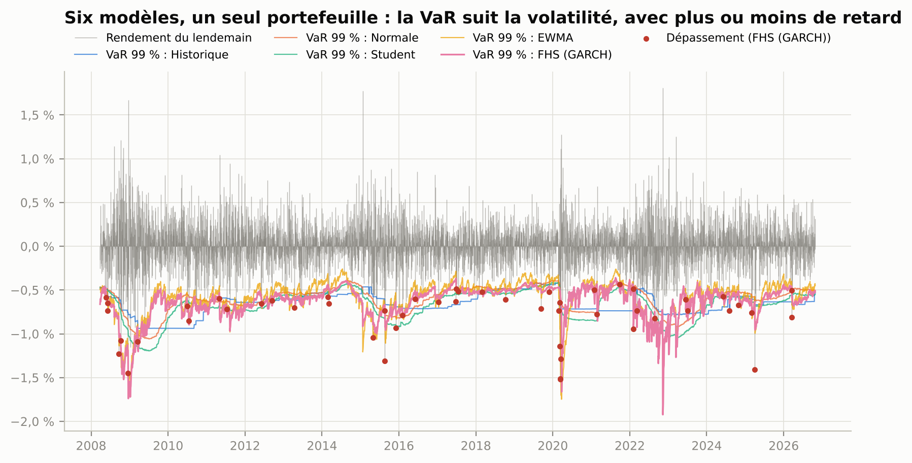
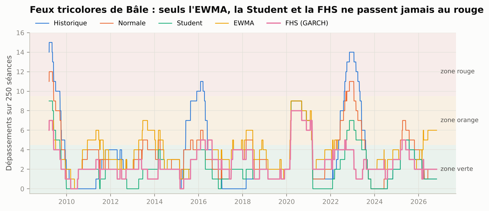
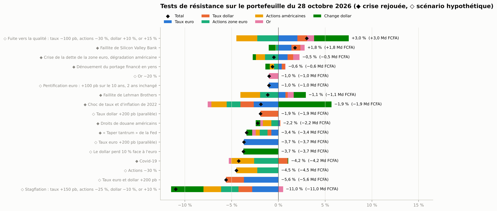
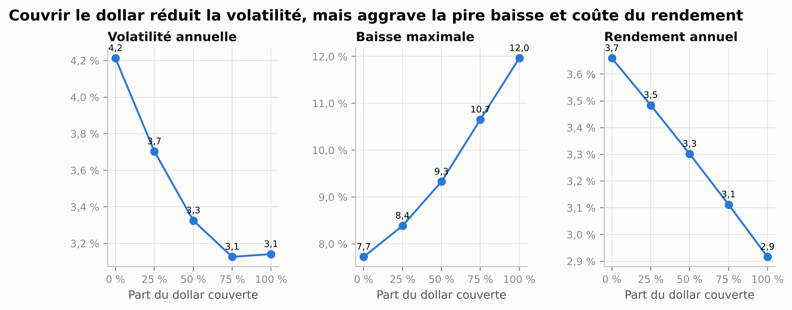

# Tableau de bord du risque de marché d'une trésorerie en FCFA

[](https://colab.research.google.com/github/Elisee-Boco/market-risk-dashboard/blob/main/notebooks/risque_de_marche.ipynb)
 

**Auteur : Elisée Boco** · Master Banque-Finance, spécialisation Marchés Financiers et Finance d'Entreprise (CESAG, Dakar)

Mesure, validation et pilotage du risque de marché d'un portefeuille de trésorerie de **100 milliards de FCFA**, comme
celui d'une banque de développement, d'une banque commerciale ou d'une caisse de retraite de l'UEMOA. Le
portefeuille est valorisé en euros, donc en francs CFA, et suivi chaque jour d'avril 2007 à octobre 2026 : six modèles
de VaR et d'Expected Shortfall, leur validation sur 4 751 séances, la décomposition du risque, dix-sept tests de
résistance, un dispositif de limites et un rapport quotidien.

**Tableau de bord interactif** :
[elisee-boco.github.io/market-risk-dashboard/tableau_de_bord/](https://elisee-boco.github.io/market-risk-dashboard/tableau_de_bord/)

> *English summary below.*

---

## La question

Quel modèle de VaR une direction des risques devrait-elle retenir pour ce portefeuille, et que révèlent les
crises de 2008 à 2025 sur ses vrais risques ?

## Le portefeuille

Allocation fixée **à l'avance** et rééquilibrée chaque jour, sur le modèle des portefeuilles de réserves (FMI, 2013) :
aucun titre n'est choisi après coup.

| Position | Poids | Valorisation |
|---|---|---|
| Liquidités en euros | 10 % | Taux à 3 mois de la courbe AAA |
| Obligations d'État zone euro 2, 5 et 10 ans | 20 %, 15 %, 10 % | Repricées chaque jour sur la courbe zéro-coupon AAA de la BCE |
| Bons du Trésor américain 2, 5 et 10 ans | 10 %, 10 %, 5 % | Repricés sur les taux au pair du Trésor, plus le change euro/dollar |
| Actions zone euro (Euro Stoxx 50) | 7,5 % | Indice |
| Actions américaines (S&P 500) | 7,5 % | Indice, plus le change |
| Or | 5 % | Contrat à terme, plus le change |

Les obligations sont **à maturité constante** (Swinkels, 2019) : chaque jour, on détient une obligation émise au pair
la veille et on la revalorise sur la nouvelle courbe. Le rendement obtenu contient le portage, le glissement sur la
courbe et l'effet des taux.

## Les résultats en bref

**Le portefeuille.** De 49 à 100 milliards de FCFA en dix-neuf ans et demi : 3,7 % par an, volatilité 4,2 %, Sharpe 0,70.
Pire baisse : −7,7 % (novembre 2021 – janvier 2023), rattrapée en avril 2024.

**Les six modèles, validés sur 4 751 séances (mars 2008 – octobre 2026)**

| Modèle | Dépassements (48 attendus) | Kupiec p | Séances en zone rouge | ES : Z2 | Rang de précision |
|---|---|---|---|---|---|
| Simulation historique, revalorisation complète | 67 | 0,007 | 8,8 % | −0,26 | 5 |
| Normale | 71 | 0,001 | 3,1 % | −0,26 | 4 |
| Student | 47 | 0,94 | 0 % | −0,07 | 3 |
| EWMA (RiskMetrics) | 74 | < 0,001 | 0 % | −0,22 | 1 |
| **Simulation historique filtrée (GARCH)** | **52** | **0,52** | **0 %** | **−0,13** | **2** |

1. **Le modèle retenu est la simulation historique filtrée par un GARCH(1,1)**, selon une règle fixée avant de voir les
   résultats : il passe le test de Kupiec, n'est jamais en zone rouge de Bâle, son Expected Shortfall passe le test
   d'Acerbi-Székely, et il suit le vrai quantile mieux que la Student.
2. **La VaR historique classique réagit trop tard** : en mars 2020, elle reste basse pendant des semaines, et elle passe
   8,8 % du temps en zone rouge. L'EWMA réagit vite mais sous-estime le risque (74 dépassements).
3. **Aucun modèle ne passe le test d'indépendance de Christoffersen** : les dépassements arrivent en grappes (2008,
   mars 2020, 2022). C'est la limite principale des VaR quotidiennes, et la raison d'être des tests de résistance.
4. **Au 28 octobre 2026**, la VaR 99 % à un jour vaut **515 millions de FCFA** (0,52 %), l'ES 97,5 % **546 millions** ;
   la VaR à dix jours, calculée directement, 2,1 milliards. Toutes les limites sont respectées.
5. **Le premier risque des mauvais jours est le dollar non couvert** : 45 % de l'Expected Shortfall, alors que la VaR
   paramétrique ne lui en attribue que 9 %. Les corrélations moyennes cachent ce que font les queues.
6. **Couvrir le dollar n'est pas une solution évidente.** Une couverture totale fait passer la volatilité de 4,2 % à
   3,1 %, mais aggrave la pire baisse (−7,7 % à −12,0 %) et coûte 0,7 point de rendement par an : en 2008 et en 2022,
   le dollar a monté quand le reste baissait.
7. **Le pire scénario est la stagflation** (taux +150 pb, actions −25 %, dollar −10 %) : −11 %, soit 11 milliards de
   FCFA. Parmi les crises rejouées, la plus coûteuse est le Covid-19 (−4,2 %).






## La méthode

| Étape | Choix | Référence |
|---|---|---|
| VaR et ES | Pertes positives, 99 % et 97,5 %, un jour ; dix jours par la racine du temps et directement | Comité de Bâle, FRTB (2019) |
| Simulation historique | 500 séances, revalorisation complète des obligations sur la courbe choquée | |
| Normale, Student | 250 séances ; degrés de liberté par maximum de vraisemblance | |
| EWMA | λ = 0,94 | J.P. Morgan, RiskMetrics (1996) |
| FHS | GARCH(1,1) sur 1 000 séances, ciblage de variance, réestimé tous les 21 jours | Barone-Adesi et al. (1999) |
| Monte-Carlo | 20 000 tirages, Student multivariée à 5 degrés de liberté, covariance EWMA, revalorisation complète | |
| Backtesting | Kupiec (1995), Christoffersen (1998), feux tricolores de Bâle (1996), Acerbi et Székely (2014), perte quantile | |
| Décomposition | Euler : ES par composante (historique) et VaR par composante (paramétrique) ; VaR incrémentale | |
| Résistance | 8 crises rejouées sur le portefeuille du jour, 9 scénarios hypothétiques, test inversé (multiple pour perdre 5 %) | |

## Contenu du dépôt

```
data/marches/            données figées (Trésor, BCE, Yahoo), sources et empreintes SHA-256
src/parametres.py        portefeuille, modèles et limites : tout ce qui est fixé à l'avance
src/donnees.py           chargement et calendrier
src/obligations.py       valorisation des obligations, maturité constante, sensibilités
src/portefeuille.py      rendements en euros, facteurs de risque, revalorisation sous scénarios
src/modeles_var.py       les six modèles de VaR et d'ES
src/backtest.py          Kupiec, Christoffersen, Bâle, Acerbi-Székely, perte quantile
src/analyses.py          décomposition, tests de résistance, limites, performance, couverture du dollar
src/excel.py             classeur de reporting (VaR recalculable par formules)
src/rapport_quotidien.py rapport de risque d'une page (HTML et PDF)
src/graphiques.py        les 14 figures
tests/test_risque.py     23 tests
notebooks/               carnet Colab pas à pas
tableau_de_bord/         tableau de bord interactif (index.html) et son générateur
main.py                  tout recalculer
```

## Reproduire

```bash
git clone https://github.com/Elisee-Boco/market-risk-dashboard.git
cd market-risk-dashboard
pip install -r requirements.txt
python tests/test_risque.py      # 23/23
python main.py                   # environ 30 secondes
```

Ou cliquer sur le badge Colab. Pour mettre les données à jour : `python src/telecharger.py`.

## Limites

- **Données quotidiennes à des heures différentes** (Francfort et New York) : un peu d'autocorrélation artificielle,
  qui explique en partie les grappes de dépassements.
- **Indices de prix sans dividendes** pour les actions : la performance est sous-estimée, pas le risque.
- **Portefeuille rééquilibré chaque jour, sans frais** : un vrai portefeuille dériverait entre deux rééquilibrages.
- **Pas de titres de l'UEMOA.** Les obligations d'État de l'Union et les actions de la BRVM n'ont pas d'historique
  quotidien public suffisant ; la réglementation des changes de l'UEMOA limiterait aussi la part en dollars d'une
  institution de l'Union.
- **Les limites** sont calibrées sur l'historique (VaR à environ son 95e centile), pas sur un appétit pour le risque
  fixé par un conseil d'administration.

## Références

- Acerbi, C. et Székely, B. (2014). Backtesting expected shortfall. *Risk*, décembre.
- Barone-Adesi, G., Giannopoulos, K. et Vosper, L. (1999). VaR without correlations for portfolios of derivative securities. *Journal of Futures Markets*, 19(5).
- Christoffersen, P. (1998). Evaluating interval forecasts. *International Economic Review*, 39(4).
- Comité de Bâle sur le contrôle bancaire (1996). Supervisory framework for the use of backtesting in conjunction with the internal models approach to market risk capital requirements.
- Comité de Bâle sur le contrôle bancaire (2019). Minimum capital requirements for market risk (FRTB).
- Engle, R. et Mezrich, J. (1996). GARCH for groups. *Risk*, 9(8).
- FMI (2013). Revised Guidelines for Foreign Exchange Reserve Management.
- Giacomini, R. et Komunjer, I. (2005). Evaluation and combination of conditional quantile forecasts. *Journal of Business & Economic Statistics*, 23(4).
- J.P. Morgan et Reuters (1996). RiskMetrics, Technical Document, 4e édition.
- Kupiec, P. (1995). Techniques for verifying the accuracy of risk measurement models. *Journal of Derivatives*, 3(2).
- Swinkels, L. (2019). Treasury bond return data starting in 1962. *Data*, 4(3).

---

## English summary

Market-risk dashboard for a 100-billion-CFA-franc treasury portfolio (euro and US government bonds repriced daily from
the ECB and US Treasury curves, equities, gold, cash), April 2007 – October 2026. Six VaR/ES models (historical
simulation with full revaluation, normal, Student-t, EWMA, GARCH-filtered historical simulation, Monte Carlo) are
backtested over 4,751 days with Kupiec, Christoffersen, the Basel traffic light and the Acerbi-Székely ES test.

- A rule fixed in advance selects the **GARCH-filtered historical simulation**: 52 exceptions for 48 expected, never in the Basel red zone.
- Plain historical simulation reacts too late (8.8% of days in the red zone); EWMA reacts fast but underestimates risk.
- No model passes Christoffersen's independence test: exceptions cluster in 2008, March 2020 and 2022.
- The unhedged dollar is the main tail risk (45% of ES), yet fully hedging it raises the maximum drawdown from −7.7% to −12.0%, because the dollar rallied when everything else fell.
- Seventeen stress tests, a limit framework, an Excel risk report with live formulas, a one-page daily report and an interactive dashboard.
